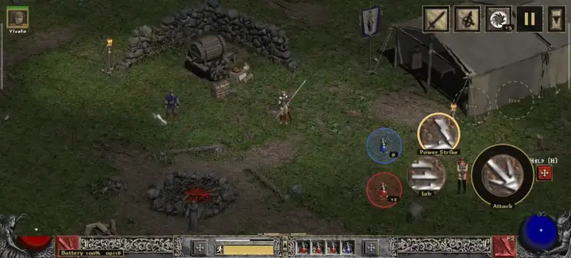
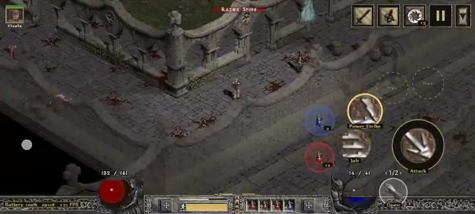
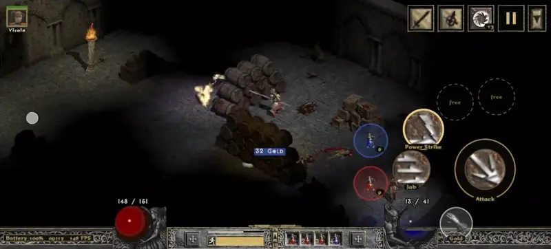
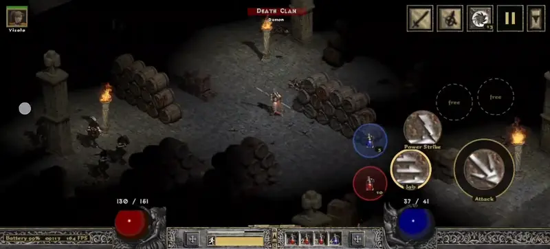
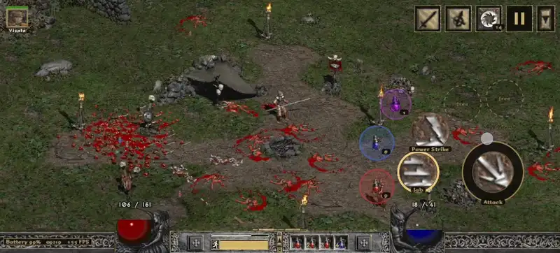
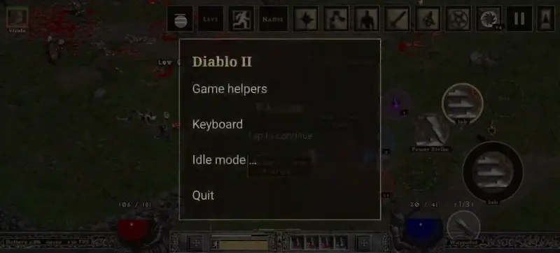

# D2Android

**Diablo II: Lord of Destruction 1.13d on Android – with touch controls and comfort features built for a phone.**

D2Android is not just "the PC game running on Android". It aims for modern UX and quality-of-life standards for a
great game: a touch layout made for thumbs, a readable widescreen picture, and helpers that take care of what is
fiddly on a phone, while the game itself stays the original.

Under the hood there is no mouse or keyboard emulation for the core actions. A small game module talks to the game
directly: walking, attacking, casting and picking up items are sent as game commands, so the character does what
your thumb means, not where a virtual pointer happens to be.

> **Disclaimer.** D2Android contains **no files from Blizzard Entertainment**. It is a fan project and is **not
> affiliated with, endorsed or supported by Blizzard Entertainment**. You need your own, purchased copy of Diablo II
> and Lord of Destruction (CD keys or an existing installation). Diablo and Blizzard Entertainment are trademarks or
> registered trademarks of Blizzard Entertainment, Inc.

## Contents

- [Screenshots](#screenshots)
- [Features](#features)
- [Requirements](#requirements)
- [Installation](#installation)
- [Updates](#updates)
- [Feedback](#feedback)
- [FAQ](#faq)
- [Roadmap](#roadmap)
- [Licences and source code](#licences-and-source-code)

## Screenshots

| | |
|:---:|:---:|
|  |  |
| Touch controls: joystick, attack and skill buttons, potions | Take wheel: items and people nearby, sorted |
|  |  |
| Map overlay (here a German game installation) | Active shrines with their remaining time |
|  |  |
| Install the game in the app, no PC needed | Game settings: app language, game size, game helpers |

### Gameplay

Short clips from one session on a phone, without sound; they play right here on the page.

<table align="center">
<tr><td align="center" width="50%"> In town: stash, inventory and the waypoint</td><td align="center" width="50%"> Outer Cloister: fighting with the joystick, attack and skill buttons</td></tr>
<tr><td align="center" width="50%"> Along the cloister walls to the door of the monastery</td><td align="center" width="50%"> Fighting in the dark halls, with the map overlay</td></tr>
<tr><td align="center" width="50%"> More fighting in the halls of the monastery</td><td align="center" width="50%"> Outside again: putting a skill on an F button and moving the buttons</td></tr>
<tr><td align="center" colspan="2"> The menu and the game helpers</td></tr>
</table>

Download the whole video in full quality: <a href="media/gameplay.mp4">gameplay.mp4</a> (about 2.5 minutes, 20 MB, no sound)

## Features

Most helpers can be switched off one by one. The goal is the vanilla experience; the helpers are there to make it
playable on a phone, not to change the game.

### Touch controls (UI)

- Joystick in the left half of the screen (can be hidden, works the same), attack button and skill buttons on the right.
- Skills on the F buttons, the attack button and the shoulder triggers: assign them in the game, buttons can be moved
  and resized.
- **Take**: one button picks up the next item, opens chests, enters portals and waypoints, talks to people.
- Top-right menu with the game windows (inventory, character, skills, quests, map), town portal, pause and item names;
  you choose which buttons stay visible.
- Bottom bar drawn with graphics from your own game files: compact (orbs outside) or as in the game, life and mana as
  numbers, skill names under the buttons.
- Battery, clock and FPS in the ornament bar (optional).
- Aim assist: attacks go to the monster in the joystick direction, the target is highlighted like with the mouse.
- On-screen keyboard for names and chat.

### Comfort (UX)

- Widescreen picture that fills the whole display, in three sizes (540 lines pixel-sharp, 600 lines as in the
  original, or 720 lines).
- Walk directly: monsters, people and item names in the way do not interrupt walking.
- Saves before every pause; pauses in the background or with the screen off; a notification brings you back or saves
  and quits.
- Background protection page that walks you through what keeps Android from ending the game.
- Buff column with the remaining time of your effects (shrines, potions).
- App in English or German; the installation without a PC also installs the German version of the game.

### Quality of life (QOL) – all optional

- **Map:** reveal the map with exits and waypoints labelled; hide it while fighting and bring it back afterwards.
- **Pick up:** gold nearby automatically; potions up to a reserve; town portal scrolls; runes; gems; jewels, rings and
  amulets.
- **Potions:** refill the belt from the inventory; drink life and mana potions automatically below a threshold
  (outside town); rejuvenation in an emergency; potions for your mercenary.

  > **Note:** this does not refill your life for you – you still manage your potions yourself. It only makes up for
  > the handicap of playing on a touchscreen.

- **Item names:** always show them (like Alt), label new loot for a few seconds, or only near the character.
- **Running:** start every game running; stamina as in the game, by stamina potion, or unlimited in single player.
- **Merchants:** talking to a merchant opens "Trade" right away.
- **Single player:** number of players (`/players`) for more life, experience and loot.
- **PlugY** (optional): shared stash, many stash pages, a larger stash, ladder rune words, autosave, taking back skill
  and attribute points, extended character stats.
- **Saved games:** share all characters and stashes as one zip file and load them on another phone; the current saves
  are backed up first.

### Installation

- **Without a PC:** the app downloads Blizzard's official installers, you type in your own CD keys, and the app installs
  and patches the game to 1.13d. See [Installation](#installation).
- **Or** copy an existing 1.13d game folder to the phone and choose it in the app.
- A start check tells you honestly if your phone or your game version is not supported.

## Requirements

- An Android phone with a **Snapdragon processor and Adreno graphics** (64-bit, Android 8 or newer).
  Tested on RedMagic 8 Pro and RedMagic 10 Pro. Other Snapdragon phones may work: **best effort, not officially
  supported.** Phones with other graphics chips (Mali, PowerVR, Xclipse) are not supported.
- About **5 GB free space** in `Download/` for the installation without a PC (less once installed).
- **Your own Diablo II and Lord of Destruction:** two CD keys (Classic and LoD), or a game folder at version 1.13d.

## Installation

1. Download `D2Android-<version>.apk` from the [latest release](https://github.com/N1v0k/D2Android-Releases/releases/latest)
   and install it (allow installing from your browser or file manager when Android asks).

   > **Play Protect:** Google Play Protect may block the installation ("Unsafe app blocked") because the app is built
   > for an older Android version. It needs that to be allowed to run the game. Tap **More details → Install anyway**.

2. Open **Diablo II**. Without a game it shows two ways: **Install the game (without a PC)** or **Choose game folder**
   (see below). The first start of the game takes about a minute longer, the app sets itself up once.

### Install the game without a PC (recommended)

The app does what you would do on a PC, with Blizzard's own files:

1. In the launcher tap **Install the game (without a PC)**. The app checks the free space in `Download/`.
2. The app downloads **Blizzard's official downloaders** for Diablo II and Lord of Destruction from Blizzard's servers
   and runs them. Depending on your Wi-Fi this takes 10 to 40 minutes. The downloaded installer files are checked
   against known checksums.
3. **Type in your two CD keys.** They are handed straight to Blizzard's installer and are **never stored, logged or
   sent anywhere else** by the app. On screen they stay masked.
4. Blizzard's installer installs the game to `Download/D2Android/Diablo2` (about 4 minutes), then the app applies
   **Blizzard's official 1.13d patch** and checks the result.
5. Tap **Use it** – the game starts.

### Alternative: copy a 1.13d game folder

If you already have Diablo II + LoD at version 1.13d on a PC: copy the whole game folder (with `Game.exe`,
`d2data.mpq`, `d2exp.mpq` …) to the phone, for example to `Download/Diablo II`, then choose it in the app: on the
first start tap **Choose game folder** (later: **Game settings → Choose game folder**). The app does not search the
phone for a game by itself, it uses the folder you choose. It checks the version; other versions (1.14, Resurrected)
do not work.

### Bring your saved games

- **From another phone with D2Android:** Game settings → **Share saved games** there, then **Load saved games** here.
- **From a PC:** copy the `save` folder of your game (`.d2s` characters, plus the stash files) into the `save` folder
  of the game folder on the phone. Characters must come from 1.13d (or older) single player.
- **PlugY:** the shared stash lives in its own file (`_LOD_SharedStashSave.sss`) next to your characters. Copy it too,
  or the shared stash starts empty. Before the first start with PlugY the app backs up your saves.

## Updates

- **Obtainium** (recommended): add `https://github.com/N1v0k/D2Android-Releases` in
  [Obtainium](https://github.com/ImranR98/Obtainium); it notifies you about new versions and installs them.
- The app itself also checks once a day whether a new version is out and shows a short note with the changes. It does
  not download anything on its own. You can turn this off in the settings. The **What's new** page lists the changes of
  every version and works offline.

Updates install over the old version; your game folder and saved games stay where they are.

## Feedback

D2Android is a hobby project. Bug reports and ideas are welcome as
[issues](https://github.com/N1v0k/D2Android-Releases/issues/new/choose) – please use the templates.

- Bugs: phone model, Android version, app version and what you did. In the game, the menu
  **≡ → Game helpers → Share diagnosis** right after the problem creates a file (what the app did in the last minutes,
  no game files) that helps a lot.
- Tested on RedMagic 8 Pro and 10 Pro. Everything else is best effort and not officially supported.
- Please do not post CD keys, game files or saved games of other people.

## FAQ

**Why 1.13d and not Resurrected or 1.14?**
1.13d is the classic version the community mods are built for (PlugY, D2DX widescreen) and runs well through a
compatibility layer. Resurrected is a different game and not supported.

**Why does Play Protect warn?**
The app is built for an older Android version, because only then may it run the game's programs from its own files.
Play Protect warns about such apps. Tap **More details → Install anyway** (see [Installation](#installation)).

**Can I play on Battle.net?**
No. D2Android is made for single player. Do not use it on Blizzard's servers.

**Is this legal? Do I need to own the game?**
Yes, you need your own purchased copy. The app ships no Blizzard files: the installation without a PC uses Blizzard's
own downloaders and your keys, the alternative uses your own game folder.

**Where are my saved games? Do they survive an update or reinstall?**
In the `save` folder of the game folder (by default `Download/D2Android/Diablo2/save`). They stay when you update or
uninstall the app. Use **Share saved games** for a backup.

**How about battery and heat?**
The game runs through a compatibility layer and keeps the CPU and GPU busy. Expect roughly the battery drain of a
mid-range 3D game. The 540-line size and pausing in the background help.

**Does it work with a controller?**
Not yet; it is on the roadmap.

**Does the app collect data?**
No. It has no accounts, no ads and no analytics. The only connections are the downloads from Blizzard during the
installation and the daily version check (one request to GitHub, can be turned off).

## Roadmap

Planned, without a fixed order or date:

- Stackable runes, gems and similar items; a bigger tome and key stacks.
- Damage numbers over monsters and a DPS display.
- Picking up items by your own list, and bringing loot to the stash by town portal when the inventory is full.
- Continuing where you left off after loading a game.
- A closer-to-the-game look for buttons and menus; text of the game no longer covered by the top buttons.
- Larger inventory and stash with touch gestures (drag, double tap).
- Build guides with suggestions for skill and attribute points.
- Controller support.
- More languages for the app and the installation.
- Syncing saved games with cloud storage.

## Licences and source code

D2Android uses free software: Wine, Box64, DXVK, Mesa (Turnip), D2DX, PlugY, ALSA and parts of Winlator, among others.
Their licences are listed in the app (**Game settings → Licences**) and in `THIRD-PARTY-NOTICES.txt` of every release.
The source code of the LGPL/GPL parts we ship comes with every release (`…-lgpl-src.zip`, see `SOURCE-OFFER.txt`).
