# D2Android

**Diablo II: Lord of Destruction 1.13d on Android – with touch and gamepad controls and comfort features built for a
phone.**

D2Android is not just "the PC game running on Android". It aims for modern UX and quality-of-life standards for a
great game: a touch layout made for thumbs, a readable widescreen picture, and helpers that take care of what is
fiddly on a phone, while the game itself stays the original.

Under the hood most core actions need no mouse or keyboard emulation. A small game module talks to the game
directly: walking, attacking, picking up items and drinking potions are sent as game commands, so the character does what
your thumb means, not where a virtual pointer happens to be.

> **Disclaimer.** D2Android contains **no files from Blizzard Entertainment**. It is a fan project and is **not
> affiliated with, endorsed or supported by Blizzard Entertainment**. You need your own, purchased copy of Diablo II
> and Lord of Destruction (CD keys or an existing installation). Diablo and Blizzard Entertainment are trademarks or
> registered trademarks of Blizzard Entertainment, Inc.

**Where to get the game:** Blizzard sells the classic Diablo II and Diablo II: Lord of Destruction as two separate
products in its own [Battle.net Shop](https://us.shop.battle.net/en-us/family/diablo-ii) (in the Diablo II section, among the classic games). After buying, you find the
CD keys in your Blizzard account under *Games & Subscriptions*. Diablo II: Resurrected is a different game and does
not work with D2Android.

## Contents

- [Screenshots](#screenshots)
- [Features](#features)
- [Requirements](#requirements)
- [Installation](#installation)
- [Updates](#updates)
- [Feedback](#feedback)
- [FAQ](#faq)
- [Roadmap](#roadmap)
- [Licenses and source code](#licenses-and-source-code)

## Screenshots

<table align="center">
<tr><td align="center" width="50%">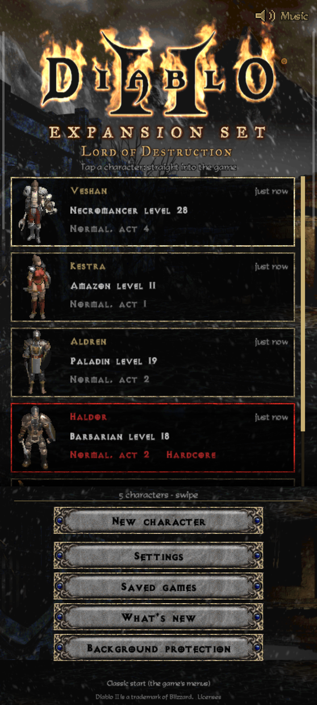 Start page: your characters, a tap starts the game</td><td align="center" width="50%">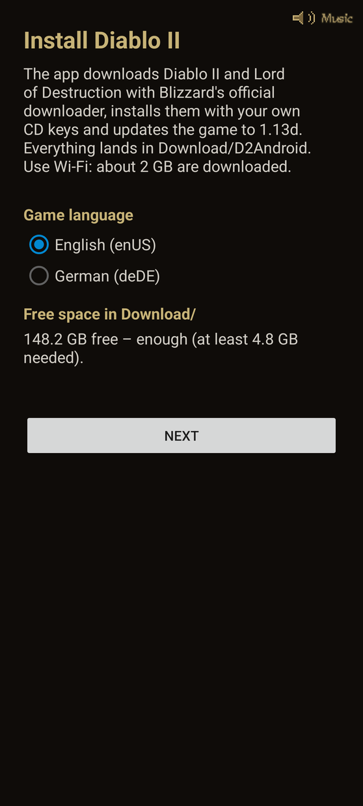 Install the game in the app, no PC needed</td></tr>
</table>

<table align="center">
<tr><td align="center" width="50%">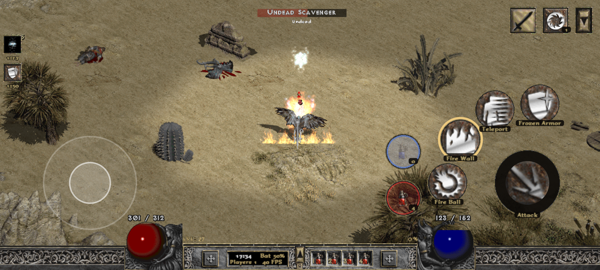 Joystick, attack and skill buttons, damage numbers, effect column and the bottom bar</td><td align="center" width="50%">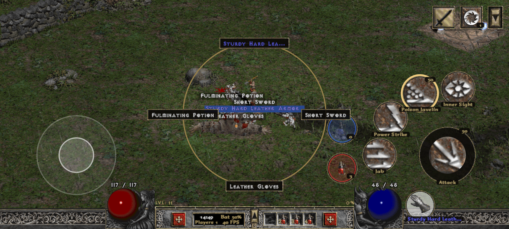 "Take": the ring of targets, chosen with a short swipe</td></tr>
<tr><td align="center" width="50%">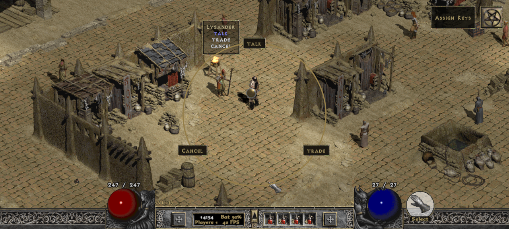 Holding "Take" on a townsperson shows their options</td><td align="center" width="50%">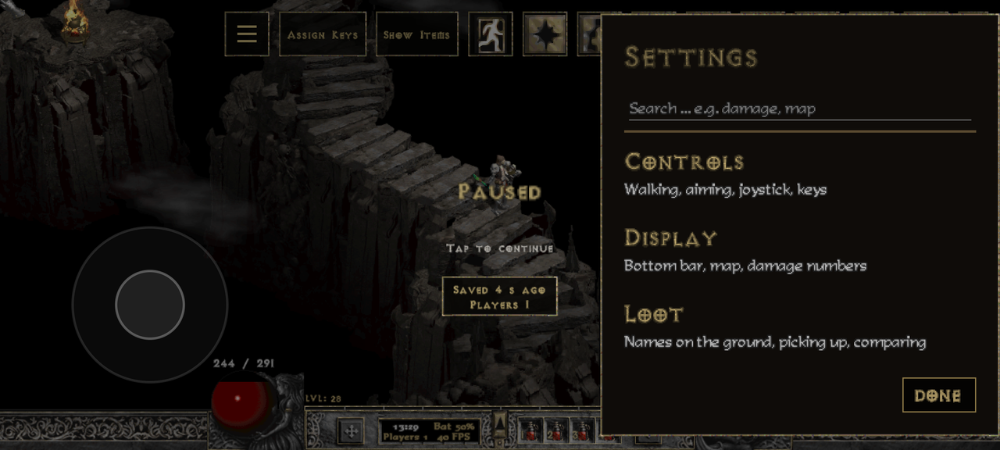 Settings: seven groups with a search</td></tr>
<tr><td align="center" width="50%">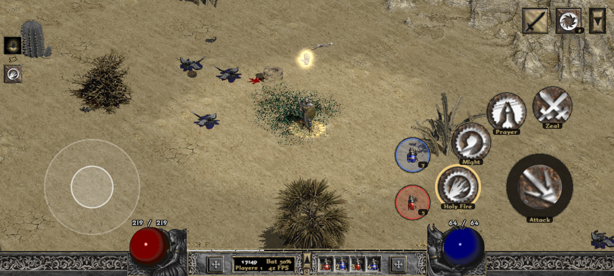 Effect column (top left): shrines with their own picture, auras, remaining time</td><td align="center" width="50%">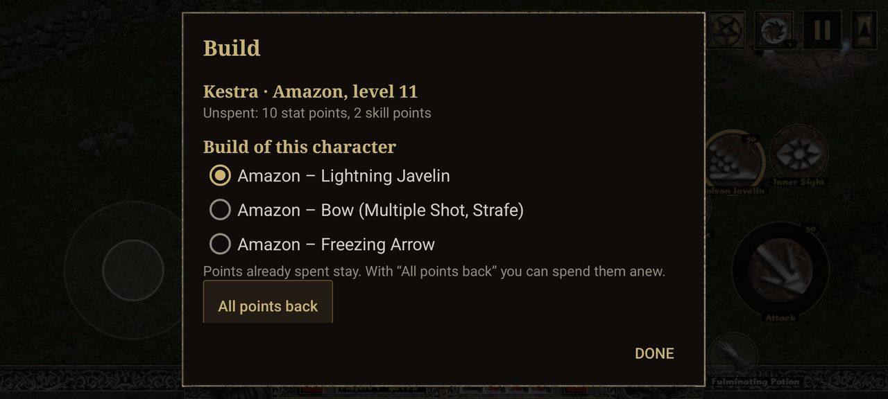 Builds for every class: pick one, the app shows where the points go</td></tr>
<tr><td align="center" colspan="2">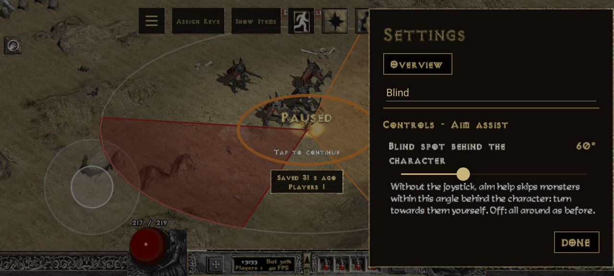 Aim assist: reach, cone and blind spot, with a live preview while you set them</td></tr>
</table>

### Gameplay

<table align="center">
<tr><td align="center" width="50%">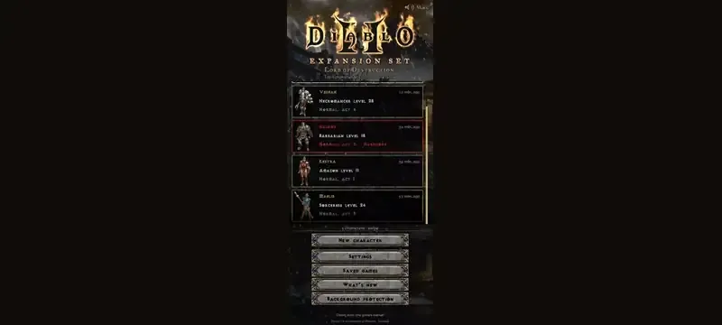 From the start page straight into the game</td><td align="center" width="50%">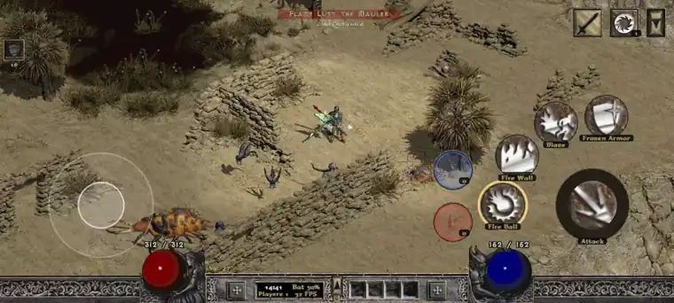 Fighting with the joystick, attack and skill buttons</td></tr>
<tr><td align="center" width="50%">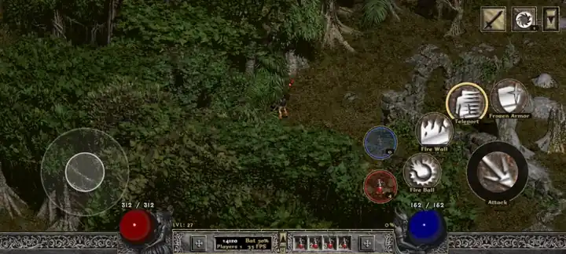 Teleport: hold the button, the ring shows where you land</td><td align="center" width="50%">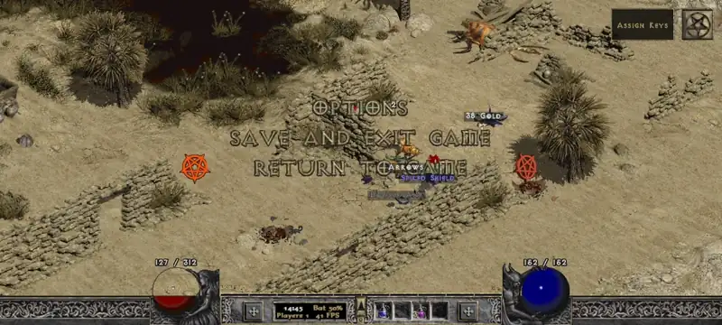 "Save and Exit" leads back to the start page</td></tr>
</table>

## Features

Most helpers can be switched off one by one. The goal is the vanilla experience; the helpers are there to make it
playable on a phone, not to change the game.

### Touch controls (UI)

- Joystick in the left half of the screen (can be hidden, works the same), attack button and skill buttons on the right.
- Skills on the F buttons, the attack button and the shoulder triggers: assign them in the game, buttons can be moved
  and resized. A shoulder trigger can also do something other than cast a skill: attack, drink a healing potion, take,
  show item names, open the map or inventory, open a town portal and more.
- **Teleport**: while you hold its button, the character teleports again and again in the joystick's direction (or the direction you drag the button); a ring on the ground shows where it lands next. It only jumps to a spot you can really reach. In front of walls and
  cliffs the ring moves to the nearest free spot; a red cross means there is nowhere to jump.
- **Take**: one button picks up the next item, opens chests, enters portals and waypoints, talks to people. The item's
  name is shown under the button in its quality colour, and your character walks up to people even around tents and
  walls. Hold **Take** for a ring of all targets around in the middle of the screen: push your thumb towards one and
  let go. Holding **Take** on a townsperson shows their options as a ring.
- Menu row at the top right with the game windows (inventory, character, skills, quests, map), town portal, pause,
  **Show Items** (item names), walk/run and **Assign Keys**; you choose which buttons stay visible when the row is
  folded. The quests button also shows in the folded row when there is quest news.
- **Assign Keys** opens the editing mode: put skills on the buttons, move them and change their size. In the skill tree,
  hold a skill and tap an F button to put it there.
- The **≡** menu holds the settings, the build page, the tour, the keyboard, switching character and quitting.
- A crisper look: the menu icons are scaled up sharply, round buttons have a gold ring like the frames of the game,
  buttons and the settings are drawn in the game's style, the buttons only appear once you are in the game, and they
  stay clear of camera cut-outs.
- A short tour through the buttons on your first game; replay it any time from the ≡ menu (**Tour**).
- Bottom bar drawn with graphics from your own game files: compact (orbs outside) or as in the game, life and mana as
  numbers, skill names under the buttons.
- **Info grid** in the bottom bar in place of the run button and stamina: four values of your choice (FPS, battery, players, clock,
  level, DPS or gold). Above the bar an **experience bar** shows how far it is to the next level, and the arrow above
  the belt opens a box with the clock instead of the game's small panel.
- **Aim assist:** attacks go to the monster in the joystick direction, the target is highlighted like with the mouse.
  There are two reaches, one for close combat and one for spells, bows and throwing weapons. Without the joystick a
  **blind spot behind the character** (60° by default) leaves monsters right behind your back alone until you turn
  towards them. Holding attack or a targeted spell with nothing in reach hits the next monster that comes close, and
  the character stops at once when you let go of the joystick.
- A tap on the mercenary's portrait opens his items; with a healing potion on the cursor it heals him.
- A tap on the death screen brings the character back.
- On-screen keyboard for names and chat.

### Gamepad

- Play with a controller over Bluetooth or USB, set up like Diablo II: Resurrected. It is on by default and can be
  turned off under **Settings → Controls → Gamepad**.
- The left stick walks, the buttons attack, take and cast skills; holding **LT** gives a second row of buttons. The
  D-pad drinks from the belt.
- Each button can be given a job: a skill on F1–F8, attack, take, a potion, town portal, the map, the inventory, swap
  weapons, run/walk and more. Skills go on the F keys in the editing mode: press the pad button, point at the skill
  with the stick, press A.
- In the inventory, stash, shops and menus the stick moves a pointer: A clicks, Y closes, holding R3 in the inventory
  sorts it.
- **Start** opens the game menu (hold: the app's ≡ menu). **View** opens the inventory by default; held, it shows a
  wheel of the game's windows.
- Holding **Take** opens the ring of targets: the stick chooses, A takes.
- The touch buttons hide while the pad is in use and come back with the first tap.

### Comfort (UX)

- **Start page** in the game's look: your characters in their equipment, with the area and time of their last save.
  A tap starts the character straight into the game, without the game's menus and with its loading animation; a long
  press picks the difficulty. **New character** leads straight to the class choice, **Classic start (the game's
  menus)** shows the game's own menus. **Save and Exit** in the game's Esc menu brings you back to the start page,
  and **Switch character** in the ≡ menu does the same.
- Diablo II's title music plays on the app pages, and taps there click like in the game; **Music** at the top switches
  both off.
- Widescreen picture that fills the whole display, in three sizes: **Large (540 lines, extra sharp)**, the default,
  **Medium (600 lines, like the original)** or **Small (720 lines, more of the world)**.
- **Frames per second:** limit the frame rate to 30, 40 or 60, on screens that support it also 90, 120 or 144, to
  save battery and keep the phone cooler. Unlimited by default.
- Walk directly: monsters, people and item names in the way do not interrupt walking.
- Saves before every pause; pauses in the background or with the screen off (the sound is muted at once); a
  notification brings you back or saves and quits.
- Safer saving: the app checks your saved games the way the game does, "Save and quit" waits until the character is
  completely written, and a cut-off stash or character is restored from the last PlugY backup (Hardcore characters
  are never replaced automatically). If Android rebuilds the game window, the app saves first and then closes. A
  character saved at 0 life loads with a full life globe.
- **Go on where I was** (a test, off by default, single player): after loading, the app brings the character back
  to the place of the last save, in areas with their own waypoint; if that place cannot be reached safely, to the
  area's waypoint. The character is protected for a few seconds after arriving or until the first attack. A tap on
  the loading picture starts in town instead.
- **Builds** for all seven classes, 27 in all, several per class. The **Build** page in the ≡ menu suggests where to put
  skill and attribute points, with strengths, weaknesses and tips; a pulsing gold frame in the skill and character
  windows marks the next point. **All points back** returns all points, **Spend all points following the build**
  hands them out again.
- On the character page one tap on "+" adds a point, a double tap five, a long press all free points.
- **Effect column** with every status effect and its remaining time: shrines with their own picture, potions, auras
  shown as active while they are on, and the remaining protection of Bone Armor. A tap shows what an effect does.
- Intro videos at the start can be skipped (on by default); the cut scenes in the game stay.
- **Settings** in the look of the game's options menu: seven groups (Controls, Display, Loot, Potions and shops, Game,
  Saved games, Help and info) with a search. In the game they open from **≡ → Settings**.
- Background protection page that walks you through what keeps Android from ending the game.
- App in English or German; the installation without a PC also installs the German version of the game.

### Quality of life (QOL) – all optional

- **Map:** reveal the map with exits and waypoints labelled; hide it while fighting and bring it back afterwards.
- **Pick up:** gold nearby automatically (also while attacking, not when the purse is full); potions up to a reserve;
  town portal scrolls; runes; gems; jewels, rings and amulets.
- **Potions:** refill the belt from the inventory; drink life and mana potions automatically below a threshold
  (outside town); rejuvenation in an emergency; potions for your mercenary.

  > **Note:** this does not refill your life for you – you still manage your potions yourself. It only makes up for
  > the handicap of playing on a touchscreen.

- **Item names:** always show them (like Alt), label new loot for a few seconds, or only near the character.
- **Running:** start every game running; stamina as in the game, by stamina potion, or unlimited in single player.
- **Merchants:** talking to a merchant opens "Trade" right away. A **Refill potions** button buys healing and mana
  potions for belt and reserve with one tap.
- **Inventory:** a long press on the inventory button sorts the inventory without opening it (the open inventory has a
  **Sort** button); sorting leaves the largest free block. A double tap on a potion puts it on the belt.
- **Stash:** the gold amount to withdraw is filled in.
- **Materials:** a storage for runes, gems and skulls that keeps them as counts (68 kinds, separate for Hardcore). Open
  it at the stash: **Deposit all** clears the inventory, a tap takes one back. It lives in its own file, your saved
  games stay untouched.
- **Larger stacks** (optional): tomes hold 80 scrolls, keys stack up to 50.
- **Loot filter:** hide the ground names of junk – **Off**, **Mild**, **Strict**, or **Own** with a tick for each kind
  (for example **Normal**, **Inferior** and **Superior** items). Only the names are hidden: **Take** skips hidden items, a
  tap right on one still picks it up. Runes, better gems, uniques, sets and the like always stay visible. The filter is kept per character.
- **Item tooltips:** a rating from 0 to 10 at the end of the tooltip, the item you wear in the same place next to the
  one you look at, and what would change (life, mana, resistances, speeds, weapon damage; green is better, red worse).
- **Damage numbers:** the damage of every hit rises over the monster, with a DPS display at the top left. Off, simple,
  or coloured by element (critical hits larger). Damage over time (poison, burning, fire wall, inferno) shows as a
  summed number in the element's colour; hits of revived monsters are grey and not counted.
- **Single player:** number of players (`/players`) for more life, experience and loot.
- **PlugY** (optional): shared stash, many stash pages, a larger stash, ladder rune words, autosave, taking back skill
  and attribute points, extended character stats; more PlugY options can be switched on in the settings.
- **Saved games:** share all characters and stashes as one zip file and load them on another phone; the current saves
  are backed up first.

### Installing the game

- **Without a PC:** the app downloads Blizzard's official installers, you type in your own CD keys, and the app installs
  and patches the game to 1.13d. See [Installation](#installation).
- **Or** copy an existing 1.13d game folder to the phone and choose it in the app.
- A start check tells you honestly if your phone or your game version is not supported.
- When something goes wrong (no network, full storage, missing permission), the page says what to do and offers a way
  on. A stopped download or patch continues where it stood.
- A mistyped CD key is noticed: if the installer only shows its start menu, the app asks whether to check the keys
  instead of waiting up to 30 minutes. A failed or cancelled installation does not leave a half-installed folder
  behind.

## Requirements

- An Android phone with a **Snapdragon processor and Adreno graphics** (64-bit, Android 8 or newer).
  Tested on RedMagic 8 Pro and RedMagic 10 Pro. Other Snapdragon phones may work: **best effort, not officially
  supported.** Phones with other graphics chips (Mali, PowerVR, Xclipse) are not supported.
- About **5 GB free space** in `Download/` for the installation without a PC (less once installed).
- **Your own Diablo II and Lord of Destruction:** two CD keys (Classic and LoD), or a game folder at version 1.13d.
- Optional: a gamepad (Bluetooth or USB).

## Installation

1. Download `D2Android-<version>.apk` from the [latest release](https://github.com/N1v0k/D2Android-Releases/releases/latest)
   and install it (allow installing from your browser or file manager when Android asks).

   > **Play Protect:** Google Play Protect may block the installation ("Unsafe app blocked") because the app is built
   > for an older Android version. It needs that to be allowed to run the game. Tap **More details → Install anyway**.

2. Open **D2Android**. Without a game it shows two ways: **Install the game (without a PC)** or **Choose game folder**
   (see below). The first start of the game takes about a minute longer, the app sets itself up once.
3. Then the start page shows your characters. Tap one to go straight into the game with it, hold it to pick the
   difficulty, or tap **New character** for the class selection. **Classic start (the game's menus)** opens the game's
   own menus as on a PC.

### Install the game without a PC (recommended)

The app does what you would do on a PC, with Blizzard's own files. The installation runs in portrait and shows each
step with its progress:

1. In the app tap **Install the game (without a PC)** and choose the game language (English or German). The
   app checks the free space in `Download/`.
2. The app downloads **Blizzard's official downloaders** for Diablo II and Lord of Destruction from Blizzard's servers
   and runs them. Use Wi-Fi: about 2 GB are downloaded, which takes 10 to 40 minutes. The downloaded installer files
   are checked against known checksums.
3. **Type in your two CD keys.** They are handed straight to Blizzard's installer and are **never stored, logged or
   sent anywhere else** by the app. On screen they stay masked.
4. Blizzard's installer installs the game to `Download/D2Android/Diablo2` (about 4 minutes), then the app applies
   **Blizzard's official 1.13d patch** and checks the result. If the patch stops (for example without network), it
   goes on with the next start; the keys are not needed again.
5. The app asks **Use the new installation?** Tap **Use it** (you can also delete the installer files, about 2 GB) –
   the start page comes up. Tap **New character** for your first character.

If something goes wrong, the page says what happened and what to do: mostly **Try again** goes on where it stood; after a failed installer it asks for the keys again.

### Alternative: copy a 1.13d game folder

If you already have Diablo II + LoD at version 1.13d on a PC: copy the whole game folder (with `Game.exe`,
`d2data.mpq`, `d2exp.mpq` …) to the phone, for example to `Download/Diablo II`, then choose it in the app: on the
first start tap **Choose game folder** (later: **Settings → Saved games → Choose game folder**). The app does not
search the phone for a game by itself, it uses the folder you choose, and it tells you what it found there. It checks
the version; other versions (1.14, Resurrected) do not work.

### Bring your saved games

- **From another phone with D2Android:** Settings → Saved games → **Share saved games** there, then **Load saved games**
  here.
- **From a PC:** copy the `save` folder of your game (`.d2s` characters, plus the stash files) into the `save` folder
  of the game folder on the phone. Characters must come from 1.13d (or older) single player.
- **PlugY:** the shared stash lives in its own file (`_LOD_SharedStashSave.sss`) next to your characters. Copy it too,
  or the shared stash starts empty. Before the first start with PlugY the app backs up your saves.

## Updates

- **Obtainium** (recommended): add `https://github.com/N1v0k/D2Android-Releases` in
  [Obtainium](https://github.com/ImranR98/Obtainium); it notifies you about new versions and installs them.
- The app itself also checks once a day whether a new version is out and shows a short note with the changes. It does
  not download anything on its own. You can turn this off in the settings. The **What's new** page lists the changes of
  every version and works offline.

Updates install over the old version; your game folder and saved games stay where they are.

## Feedback

D2Android is a hobby project. Bug reports and ideas are welcome as
[issues](https://github.com/N1v0k/D2Android-Releases/issues/new/choose) – please use the templates.

- Bugs: phone model, Android version, app version and what you did. In the game, the menu
  **≡ → Settings → Help and info → Share diagnosis** right after the problem creates a file (what the app did in the
  last minutes, no game files) that helps a lot. **Report a bug** right below it opens the bug form with phone model,
  Android version and app version already filled in.
- Tested on RedMagic 8 Pro and 10 Pro. Everything else is best effort and not officially supported.
- Please do not post CD keys, game files or saved games of other people.

## FAQ

**Why 1.13d and not Resurrected or 1.14?**
1.13d is the classic version the community mods are built for (PlugY, D2DX widescreen) and runs well through a
compatibility layer. Resurrected is a different game and not supported.

**Why does Play Protect warn?**
The app is built for an older Android version, because only then may it run the game's programs from its own files.
Play Protect warns about such apps. Tap **More details → Install anyway** (see [Installation](#installation)).

**Can I play on Battle.net or with others?**
No. D2Android is made for single player. In the main menu, Battle.net and Other Multiplayer (TCP/IP, Open
Battle.net) do nothing, and the game helpers work only in single player. Do not use it on Blizzard's servers.

**Is this legal? Do I need to own the game?**
Yes, you need your own purchased copy. The app ships no Blizzard files: the installation without a PC uses Blizzard's
own downloaders and your keys, the alternative uses your own game folder.

**Where are my saved games? Do they survive an update or reinstall?**
In the `save` folder of the game folder (by default `Download/D2Android/Diablo2/save`). They stay when you update or
uninstall the app. Use **Share saved games** for a backup.

**How about battery and heat?**
The game runs through a compatibility layer and keeps the CPU and GPU busy. Expect roughly the battery drain of a
mid-range 3D game. A frame rate limit (**Settings → Game → Frames per second**), the 540-line size and pausing in the
background help.

**Does it work with a controller?**
Yes. Connect a gamepad over Bluetooth or USB; it is set up like Diablo II: Resurrected. See [Gamepad](#gamepad).

**Does the app collect data?**
No. It has no accounts, no ads and no analytics. The only connections are the downloads from Blizzard during the
installation and the daily version check (one request to GitHub, can be turned off).

## Roadmap

Planned, without a fixed order or date:

- Picking up items by your own list (the loot filter already hides the names of junk), and bringing loot to the stash by
  town portal when the inventory is full.
- Continuing where you left off in more places than areas with their own waypoint.
- Even closer to the game: more of the remaining menus in the look of the game, and text of the game never covered by
  the buttons at the top.
- A larger inventory and stash with more touch gestures (sorting and the double tap on potions are already in).
- More languages for the app and the installation.
- Syncing saved games with cloud storage.

## Licenses and source code

D2Android uses free software: Wine, Box64, DXVK, Mesa (Turnip), D2DX, PlugY, ALSA and parts of Winlator, among others.
Their licenses are listed in the app (**Settings → Help and info → Licenses**, or **Licenses** on the start page) and
in `THIRD-PARTY-NOTICES.txt` of every release. The source code of the LGPL/GPL parts we ship comes with every release
(`…-lgpl-src.zip`, see `SOURCE-OFFER.txt`).
